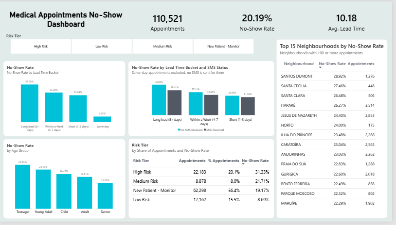
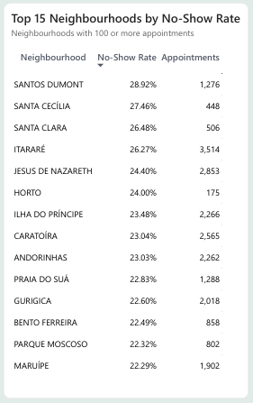

# Medical Appointment No-Show Analysis

**Tools:** SQL Server (cleaning, analysis, risk scoring) · Power BI (dashboard)
**Links:** [Interactive dashboard](LINK) · [SQL scripts](LINK)

---

## Project Background

Missed appointments waste clinician time, rooms and staff. They delay care for the patient who missed the visit, and also for other patients who could have used the slot. Clinics usually treat every booking as equally reliable, so they only learn which appointments were at risk after the slot sits empty. This affects clinic management and scheduling staff (lost capacity), clinicians (idle gaps) and patients (delayed care and longer waits).

This project uses the public [Medical Appointment No-Shows dataset](https://www.kaggle.com/datasets/joniarroba/noshowappointments) from Kaggle, with appointment records from public clinics in Brazil. Working as a data analyst on a portfolio project, I set out to find which appointments are at risk before they are missed. I used SQL Server to clean and analyse the data and Power BI to build the dashboard.

The question: **which bookings are most likely to be missed, and what can a clinic do about it?**

Insights and recommendations cover four areas: booking lead time, patient age group, SMS reminders and patient risk tiers.

---

## Project Objective

To find out which appointments are most likely to be missed and why, and to turn those patterns into practical suggestions. The analysis is meant to support decisions on:

- **Reminder strategy:** who should receive reminders, and when a second confirmation is worth the effort.
- **Scheduling rules:** whether to limit how far ahead appointments are booked, and how to treat high-risk slots.
- **Targeting:** which patient groups and neighbourhoods to prioritise for outreach or a pilot.
- **New patients:** whether first-time patients, who cannot be scored from history, need a separate rule.

---

## Executive Summary

Of 110,521 appointments, 20.19% were no-shows, about 22,300 empty slots. They are not random, and three messages matter most:

1. **Lead time is the biggest driver.** The no-show rate rises from 4.65% for same-day bookings to 32.06% for bookings made 8 or more days ahead.
2. **Reminders are linked to better attendance, especially for long-lead bookings.** For appointments booked 8+ days ahead, 29.41% of patients who received an SMS missed their appointment, against 36.05% of those who didn't.
3. **A simple risk tier flags the bookings most likely to be missed.** High Risk appointments are missed 31.33% of the time against 8.69% for Low Risk. However, 56.4% of bookings are first-time patients who can't be scored yet.

Younger patients also miss more often: teenagers (25.95%) compared with seniors (15.31%).

---

## Data

### Overview

The data is one table of appointment records from the [Kaggle Medical Appointment No-Shows dataset[Medical Appointment No-Shows dataset](https://www.kaggle.com/datasets/joniarroba/noshowappointments). Each row is one booked appointment.

| | Raw | After cleaning |
|---|---|---|
| Rows | 110,527 | 110,521 |
| Columns | 14 | 15 (added `Lead_Time_Days`) |
| Appointment dates | | 29 Apr 2016 to 8 Jun 2016 |

Bookings were made between 10 November 2015 and 8 June 2016.

**Original columns:** PatientId, AppointmentID, Gender, ScheduledDay, AppointmentDay, Age, Neighbourhood, Scholarship, Hipertension, Diabetes, Alcoholism, Handcap, SMS_received, No_show.

**Exploration:** I started in SQL Server by checking row and column counts, data types, categories (gender, no-show, neighbourhood, scholarship, handicap), the age range and the date range. This showed which issues needed checking.

### Data Quality

| Issue found | Action | Rows affected | Why |
|---|---|---|---|
| Negative ages | Deleted the row | 1 | Age can't be negative, so it's a data entry error |
| Date formats incorrect | Converted `ScheduledDay` to DATETIME and `AppointmentDay` to DATE | All rows (none removed) | Dates had to be proper date types to calculate lead time correctly |
| Appointment date before booking date (negative lead time) | Calculated `Lead_Time_Days`, then deleted rows below 0 | 5 | The appointment can't happen before it was booked, so these dates are invalid |
| Duplicate appointments | Checked for repeated `AppointmentID`s, none found | 0 | Makes sure each row is a unique appointment |
| Missing values | Checked all 14 columns for nulls, none found | 0 | Makes sure the data is complete before analysis |

**Result:** 110,527 rows reduced to 110,521 (6 rows removed). Repeated PatientIds were kept, since one patient can have several appointments.

### New Columns

| Column | Built in | Definition |
|---|---|---|
| `Lead_Time_Days` | SQL | Days between booking date and appointment date |
| `lead_time_buckets` | SQL and Power BI | Same day (0), Short (1-3), Within a Week (4-7), Long lead (8+) |
| `Age_Group` | SQL and Power BI | Child (0-12), Teenager (13-19), Young Adult (20-39), Adult (40-59), Senior (60+) |
| `SMS_Status` | Power BI | "SMS received" if SMS_received = 1, otherwise "No SMS" |
| `prior_appointments`, `prior_no_shows`, `prior_no_show_rate` | SQL | A patient's earlier appointments, earlier no-shows and their rate |
| `risk_tier` | SQL | High, Medium, Low, or New Patient - Monitor |

Lead Time Days, Lead time buckets and age groups were created in SQL for the analysis and recreated in Power BI for the dashboard. The cleaned table and the risk scoring view were loaded into Power BI to build the dashboard.

**Risk tier rule:** returning patients are High Risk if at least half of their prior appointments were missed or the booking was made 8+ days ahead; Medium if at least 20% were missed or it was booked 4-7 days ahead; otherwise Low. First-time patients are labelled New Patient - Monitor.

**Scripts:** [Data Exploration](SQL-Scripts/Data%20Exploration.sql) · [Data Cleaning](SQL-Scripts/Data%20Cleaning.sql) · [Data Analysis](SQL-Scripts/Data%20Analysis.sql) · [Patient Level Scoring](SQL-Scripts/Patient%20Level%20Scoring.sql)

---

## Insight Deep Dive

### 1. Longer lead times mean more missed appointments

The rate rises at every step, from 4.65% for same-day bookings to 32.06% for bookings made 8+ days ahead. Bookings made 8+ days ahead are missed about 1.4 times as often as those made 1-3 days ahead, and about 7 times as often as same-day bookings. Lead time is also the one driver a clinic controls through how it schedules.

### 2. Teenagers and young adults miss appointments most often

Teenagers (25.95%) miss appointments about 1.7 times as often as seniors (15.31%), a gap of 10.6 points. Teenagers and young adults (23.11%) sit above the 20.19% average, while adults (18.81%) and seniors sit below it. This shows a pattern, not a cause.

### 3. SMS reminders are linked to better attendance, mostly for long-lead bookings

Patients who received an SMS missed fewer appointments in every lead time bucket, and the gap grows with lead time: 36.05% vs 29.41% for 8+ days, 27.11% vs 23.97% for 4-7 days, and 22.99% vs 21.30% for 1-3 days. Same-day appointments are excluded because no SMS is sent for them. This is an association, not proof that SMS causes the difference.

### 4. A simple risk tier flags the bookings most likely to be missed

High Risk appointments (31.33%) are missed about 3.6 times as often as Low Risk ones (8.69%). They make up 20.1% of bookings but about 31% of all no-shows. First-time patients are 56.4% of bookings and about 54% of no-shows, but they can't be scored because there is no earlier history for them. The tier combines prior no-shows with lead time, so part of the separation comes from the lead time effect in Insight 1.

### Supporting view: neighbourhoods

Among neighbourhoods with 100 or more appointments, Santos Dumont has the highest no-show rate (28.92% across 1,276 appointments). Itararé produces the most missed appointments of the top group, about 920 from 3,514 appointments at a 26.27% rate, so it is a good place to pilot an intervention. Differences between neighbourhoods may reflect patient mix, such as age and lead time, rather than location.

---

## Recommendations

| Finding | Recommendation |
|---|---|
| Bookings made 8+ days ahead have the highest no-show rate (32.06%) | Add a second confirmation (a call or a "reply to confirm" message) for appointments booked 8 or more days ahead, or offer shorter booking windows where possible. |
| SMS recipients missed fewer appointments in every lead time bucket, most clearly for long-lead bookings (29.41% vs 36.05%) | Send SMS reminders for every appointment booked at least one day ahead, and make sure phone numbers are captured at booking. |
| High Risk bookings are missed 31.33% of the time against 8.69% for Low Risk | Use confirmation calls or selective overbooking for High Risk slots only, instead of overbooking across the board. |
| First-time patients are 56.4% of bookings and about 54% of no-shows, but can't be scored | Use a simple rule for new patients based on lead time and age, since they have no history. |
| Teenagers (25.95%) and young adults (23.11%) miss the most. Santos Dumont and Itararé stand out among neighbourhoods | Pilot targeted outreach (such as easy rebooking options) for these age groups, starting in Itararé, which has the most missed appointments, and Santos Dumont, which has the highest rate. |

These are suggestions to test, not proven fixes. A pilot with a before-and-after comparison of the no-show rate would show whether they work.

---

## Assumptions and Caveats

### Assumptions

- **Removed rows:** 6 rows (1 negative age, 5 appointment dates before the booking date) were deleted. The values were impossible, and there was no way to check them with whoever entered the data, so I could not correct them.
- **No-show:** an appointment counts as a no-show when `No_show = 'Yes'`.
- **Lead time:** the number of days between the booking date and the appointment date.
- **Repeated patients:** repeated PatientIds were kept, because one patient can book several appointments.

### Caveats

- **Public dataset.** The data comes from Kaggle and is used for a portfolio project, not for a real clinic's operations.
- **SMS comparison.** Same-day appointments are excluded, because no SMS is sent for them.
- **Short time window.** Appointments cover about six weeks (29 April to 8 June 2016), which is too short to show seasonal patterns, and the findings may not hold for other periods.
- **Short patient history.** Patient history only covers this window, so 56.4% of bookings are labelled "New Patient - Monitor", even if the patient has visited before.
- **Neighbourhoods.** Those with fewer than 100 appointments are excluded from the ranking. The cut-off is a judgement call, and differences between neighbourhoods may reflect patient mix rather than location.
- **Associations, not causes.** The findings show patterns, and the risk tiers were tested on the same data they were built from.

